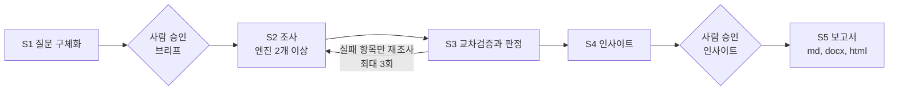

# UX 데스크리서치 하네스

주제를 한 문장으로 주면 조사 범위를 함께 정하고, 여러 딥리서치 엔진으로 조사한 뒤, **원문과 대조해 확인된 사실만으로** 보고서(md, docx, html)를 만드는 [Claude Code](https://claude.com/claude-code) 하네스입니다.

UX 기획, 서비스 기획, 마케팅 리서치에서 새 주제를 맡을 때마다 하는 데스크리서치를 대상으로 합니다.

## 왜 만들었나

딥리서치 엔진의 결과를 그대로 쓰면 이런 오류가 섞입니다.

- 인용한 원문에 없는 수치
- 다른 업종이나 다른 나라의 수치를 이 시장의 근거처럼 쓴 문장
- 몇 년 전 수수료나 요금을 현재 값처럼 쓴 문장
- 조사 보고서에 끼어든 "전략적 제언"

사람이 하나씩 원문을 열어 확인하던 일을 판정 스크립트와 게이트로 옮겼습니다. 판정을 통과하지 못한 문장은 보고서에 들어가지 않습니다.

## 흐름



- **단계 전환은 판정 스크립트의 종료 코드로만** 정합니다. 0 통과, 1 실패, 2 오류(멈추고 사람을 부름).
- **S3 판정**은 세 겹입니다.
  1. 스크립트: 출처 번호, 원문 속 숫자, 게시일, 금지 섹션을 문자열로 대조
  2. Jev(OpenRouter에서 쓰는 판정 모델): 주장마다 원문이 뒷받침하는지, 같은 도메인인지 판정
  3. 감사: 다른 모델이 판정 일부를 라벨을 가린 채 다시 판정
- **교차 검사**: 단계마다 작업한 에이전트가 아닌 다른 에이전트가 검사합니다. 지적은 모두 되돌리고 최대 3회까지 반복합니다.

## 시작하기

준비물: Claude Code, Python 3.12 이상, docx를 만들려면 [pandoc](https://pandoc.org).

```bash
git clone https://github.com/jinyorim/ux-desk-research-harness.git
cd ux-desk-research-harness
pip install -r requirements.txt
cp .env.example .env    # 키 값을 채웁니다. .env는 git에 올라가지 않습니다
```

| 키 | 쓰는 곳 | 필수 |
| --- | --- | --- |
| `EXA_API_KEY` | 조사 엔진, 원문 수집 | 필수 |
| `OPENROUTER_API_KEY` | Jev 판정 | 필수 |
| `GEMINI_API_KEY` | 조사 엔진 | 필수 |
| `OPENAI_API_KEY` | 판정 감사 | 권장 |
| `ANTHROPIC_API_KEY`, `PERPLEXITY_API_KEY` | 예비 엔진 | 선택 |

설치가 맞는지는 들어 있는 예시 사례로 확인합니다.

```bash
python harness/verify.py --fixtures
# "놓침 0건 / 잘못된 실패 0건"이 나오면 정상
```

## 사용법

폴더에서 `claude`를 실행하고 이렇게 말합니다.

| 말 | 동작 |
| --- | --- |
| `리서치 시작: <주제 한 문장>` | S1부터 시작. 몇 가지 질문으로 브리프를 만들고 승인을 받음 |
| `이어서` | 멈춘 단계부터 다시 |
| `다시 판정` | S3만 다시 |
| `보고서 만들어` | S5만 (S3 통과 상태일 때) |

결과는 `runs/<slug>/`에 쌓입니다. 브리프를 직접 쓰고 싶으면 [`docs/brief-template.md`](docs/brief-template.md)의 `{{주제}}` 같은 칸을 채우면 됩니다.

## 보고서에 들어가는 것

- 시장 변화(MARKET), 경쟁사(COMPETITORS)와 경쟁사별 SWOT, 포지셔닝 맵, 사용자 불편(SOLUTION GAP)
- 사용자 관점 인사이트와 HMW(How Might We) 질문
- 교차검증 결과: 확정, 보류, 폐기 항목과 그 이유
- 순서와 절차는 흐름도로, 모든 사실 문장에는 원문 링크가 달린 출처 번호

세부 작업 표 형식은 [`market-modules`](.claude/skills/market-modules/SKILL.md), 인사이트 쓰는 법은 [`ux-insight`](.claude/skills/ux-insight/SKILL.md), 보고서 구성은 [`report-writing`](.claude/skills/report-writing/SKILL.md)에 있습니다.

## 구성

| 경로 | 내용 |
| --- | --- |
| [`CLAUDE.md`](CLAUDE.md) | 하네스 진입점. 트리거, 단계, 금지 사항 |
| `.claude/agents/` | interviewer, researcher, judge, analyst, publisher |
| `.claude/skills/` | ux-insight, report-writing, market-modules, build-with-exa |
| `harness/rules.yaml` | 모든 수치와 임계값의 단일 출처 |
| `harness/engines.yaml` | 엔진과 모델 ID |
| `harness/judge/` | 판정, Jev 호출, 감사, 교차 검사 기록, 한국어 문장 검사, 세부 작업 표 검사 |
| `harness/publish/` | html 보고서 생성과 검사 |
| `harness/tests/` | 판정 회귀 검사 사례, 세부 작업 표 예시 |
| `docs/` | 설계 문서 |

설계 문서 읽는 순서: [`prd.md`](docs/prd.md) → [`purpose.md`](docs/purpose.md) → [`pipeline.md`](docs/pipeline.md) → [`gates.md`](docs/gates.md) → [`roles.md`](docs/roles.md) → [`review.md`](docs/review.md) → [`verification.md`](docs/verification.md)

## 검사 명령

| 명령 | 검사 |
| --- | --- |
| `python harness/verify.py --fixtures` | 판정 규칙을 바꾼 뒤 회귀 검사 |
| `python harness/judge/run.py <slug> --stage script` (또는 `jev`) | S3 판정 |
| `python harness/judge/audit.py <slug> --target s3` (또는 `s5`) | 다른 모델로 판정 감사 |
| `python harness/judge/check_modules.py <md>` | 세부 작업 표 형식과 계산 |
| `python harness/judge/check_korean.py <md>` | 한국어 문장 (번역투, 금지 문장부호) |
| `python harness/publish/check_html.py <html>` | html 보고서 |

## 출처와 라이선스

- 참고하거나 가져온 스킬, 도구, 라이브러리와 출처: [`docs/skills-inventory.md`](docs/skills-inventory.md)
- `.claude/skills/build-with-exa/`는 [exa-labs/agent-skills](https://github.com/exa-labs/agent-skills)(MIT)에서 가져왔고 원본 라이선스를 같은 폴더에 두었습니다.
- 이 저장소: [MIT](LICENSE)
